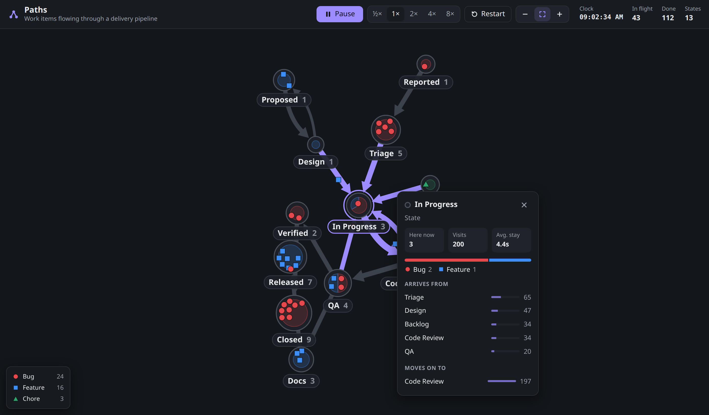
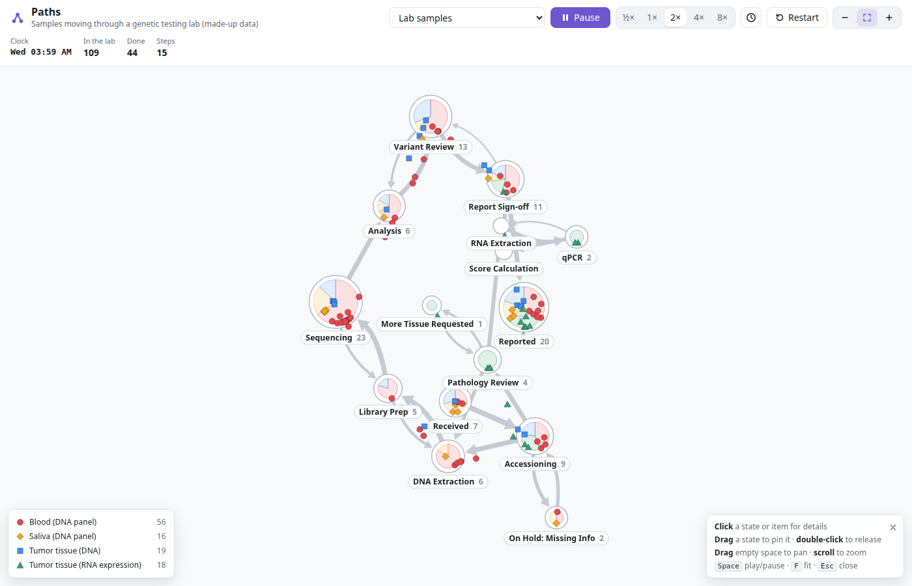
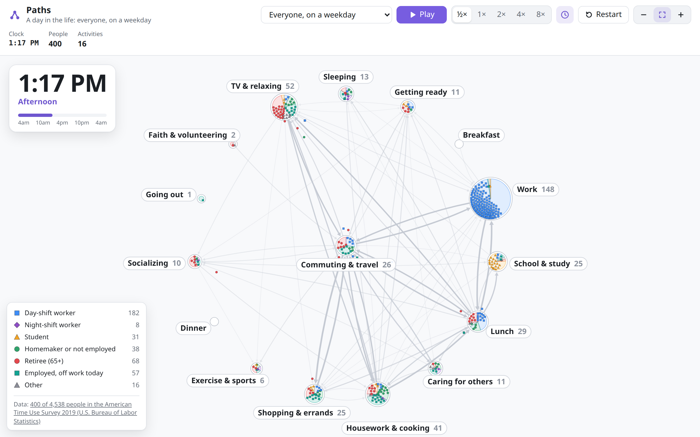

# Paths

**A live, animated map of work moving through a process.**

**[Try the live demo →](https://markmckellar.github.io/paths/)** (opens on a day in the life) ·
**[Lab samples →](https://markmckellar.github.io/paths/#lab)** ·
**[Delivery pipeline →](https://markmckellar.github.io/paths/#pipeline)** ·
**[Configure it with your own data ↓](#configure-it)**

Each state in a workflow is a circle. Each item is a small shape that moves from state to state as its status
changes. The paths it takes are drawn as arrows, and they get thicker as more items follow them. Over time the
picture *becomes* the process: where work piles up, which steps send items back for rework, and how long things
sit in each state.



The engine is generic: it draws any stream of "item X entered state Y at time T" events, such as samples moving
through lab processing steps, orders through fulfillment, or tickets through support. The demo has three kinds of
data, chosen from the picker at the top:

- **Delivery pipeline.** Bugs, features and chores moving through a software delivery process.
- **Lab samples.** Patient samples moving through a genetic testing lab, from arrival to signed-out report
  (made-up data). Blood, saliva and tumor samples share extraction, library prep, sequencing, analysis and
  review, so you can see where they converge and queue up (long sequencing runs build a backlog). Failed QC
  sends a sample back a step, a requisition missing information goes on hold, and a tumor sample can need more
  tissue before it carries on. A big clock shows the day, time and shift (day, evening or night), with a bar for how far
  through the week it is.
- **A day in the life.** Real people's days from the American Time Use Survey: when they sleep, commute, work,
  eat, look after others and relax. Pick everyone on a weekday or weekend, or day-shift workers, night-shift
  workers, students, homemakers or retirees, and watch the day go round a clock-like circle of activities.





## What you can do

- **Watch it build itself.** States appear as items first reach them, and the layout arranges itself as the
  network grows, spreading out to fill the window and untangling crossed paths as it goes. The view follows
  the graph until you take over.
- **Ask a state what's going on.** Click a state to see how many items are there now (by type), total visits,
  the average time items spend there, and where items arrive from and go next, ranked by volume.
- **Follow one item.** Click an item to see its whole journey with timings. Its route lights up on the map.
- **Arrange it your way.** Drag a state to pin it in place, and double-click it to release it. Pan, zoom, or pinch
  on a touch screen.
- **Control time.** Play, pause, and run from ½× to 8× speed. Turn on the big clock to see the time of day (and,
  for a day's data, how far through the day it is) right on the graph.
- **Switch data sets.** Each one has its own link (for example `#lab` or `#life-night`, or `?demo=lab` where a site
  drops the `#` part), so you can share a view.

Works in light and dark mode, on desktop and on phones.

## Configure it

Paths has two layers, and everything specific to a data set is configuration rather than code:

1. **The engine** (`src/engine/`, framework-free TypeScript). A `World` takes options for how items look and how the
   graph is drawn, and you feed it events.
2. **Scenarios** (`src/scenario.ts`). A scenario bundles one data set for the demo app: its events, its clock, its
   wording, and which display options it turns on. The picker lists every scenario.

### Engine options (`WorldOptions`)

| Option | What it does |
| --- | --- |
| `walkerTypes` | The kinds of item: key, label, colour and shape (`circle`, `square`, `triangle`, `diamond`). |
| `exits` | Items that have been in a matching state for a while leave, e.g. finished work. |
| `teleports`, `endpointMods` | Re-routing rules applied to matching moves. |
| `layout` | Spacing, path length, item size and how quickly things move. |
| `pathMemoryMs` | Show **recent** traffic: each path fades out this long after it was last used. Unset, paths show all-time traffic. Use it for cyclic data such as daily routines. |
| `labels.placement` | `'below'` each state (default), or `'outside'`: pointing away from the middle, for fixed layouts like a circle. |
| `labels.screenPx` | Draw labels at a fixed on-screen size at any zoom (a little smaller on phones). Unset, they scale with the map. |
| `fillView` | Spread the layout out to fill the window, keeping clear of the clock and legend ([how](#filling-the-window)). On by default; turn it off for fixed layouts. |
| `untangle` | Move states now and then so fewer paths cross ([how](#untangling-crossed-paths)). On by default; `false` turns it off. |

Junctions (states) can also be **pinned** in place. Set `anchored` as well for a deliberate layout, so they aren't
marked as pinned by hand. `world.settle()` runs the layout ahead of time, so items start settled.

```ts
import { World } from './engine/world'

const world = new World({
  walkerTypes: [{ key: 'order', label: 'Order', color: '#3e8ef7', shape: 'square' }],
  exits: [{ junction: 'Delivered', afterMs: 60_000 }],
})

world.enqueue([
  { time: Date.parse('2026-01-05T09:00'), walker: 'order-1', walkerType: 'order', junction: 'Placed' },
  { time: Date.parse('2026-01-05T09:20'), walker: 'order-1', walkerType: 'order', junction: 'Packed' },
])
```

### Scenario options (`Scenario`)

| Field | What it does |
| --- | --- |
| `key`, `group`, `label`, `subtitle` | Its link (`#key`), where it sits in the picker, and the line under the title. |
| `worldOptions(random)` | The engine options above. |
| `createFeed(seed, start)` | An object whose `fill(until)` returns the events due up to a time. Can be endless. |
| `startTime()`, `timeScale`, `defaultSpeed` | When the clock starts, how much simulated time passes per real millisecond at 1×, and the starting speed. |
| `setup(world)` | Runs on a fresh world, e.g. to pin states in a fixed layout. |
| `startSettled` | Apply the first events and settle the layout before the clock starts, so items begin where they are. |
| `words` | What to call states and items ("State"/"Activity", "In flight"/"People", ...). |
| `formatClock`, `formatTimeOfDay` | The clock text, and clock times in an item's history instead of "+2h 10m". |
| `bigClock`, `timeCaption`, `cycle` | Show the big on-graph clock by default, a caption under it ("Morning"), and for repeating data a progress bar with scale labels. |
| `showDone`, `restartHint`, `credit` | Whether a "Done" count makes sense, the Restart tooltip, and a data credit under the legend. |

### Example: importing "a day in the life"

The time-use data sets were added purely through configuration. Here is the whole path from raw survey files to
the demo.

**1. Get the data.** The [American Time Use Survey](https://www.bls.gov/tus/) (U.S. Bureau of Labor Statistics,
public domain) asks thousands of people to describe one day, 4am to 4am, activity by activity, with start times.
Download the Activity, Respondent and Roster files for a year (`atusact-2019.zip`, `atusresp-2019.zip`,
`atusrost-2019.zip`) into `data-raw/`, which git ignores.

**2. Build a compact data file.** [`scripts/build-timeuse.py`](scripts/build-timeuse.py) (standard-library Python)
does the survey-specific work once, offline:

```sh
python3 scripts/build-timeuse.py data-raw 2019 src/demo/timeuse/atus-2019.json
```

- puts each person in a group from their diary day: day-shift or night-shift worker (half or more of their work
  between 8pm and 6am), student, homemaker, retiree, ...
- maps 400-odd survey activity codes onto 16 activities, naming meals breakfast, lunch or dinner by time of day,
  and merges back-to-back repeats
- samples a few hundred people per data set **using the survey weights**, so each sample is representative

The result is 66 KB compressed. Each person is a row of `[group, age, start minute, activity, start minute,
activity, ...]`:

```json
{ "activities": [{ "key": "sleep", "label": "Sleeping" }, ...],
  "groups": [{ "key": "day", "label": "Day-shift worker" }, ...],
  "datasets": [{ "key": "weekday", "label": "Everyone, on a weekday", "respondents": 4538,
                 "people": [[0, 42, 0, 0, 210, 15, 255, 8, ...], ...] }, ...] }
```

**3. Turn people into events.** [`src/demo/timeuse.ts`](src/demo/timeuse.ts) replays each person's day as
"entered activity at time T" events, then the same day again, forever:

```ts
fill(until: number): WorldUpdate[] {
  const out: WorldUpdate[] = []
  while (this.startTime + this.nextDay * DAY_MS <= until) {
    const dayStart = this.startTime + this.nextDay * DAY_MS
    for (const p of this.people)
      for (const [minute, activity] of p.day)
        out.push({ time: dayStart + minute * 60_000, walker: p.name, walkerType: p.group, junction: activity })
    this.nextDay++
  }
  return out
}
```

**4. Describe it as a scenario.** The rest is settings:

```ts
{
  key: 'life-weekday',
  label: 'Everyone, on a weekday',
  timeScale: 600,                                  // at 1×, one real second is ten minutes of the day
  worldOptions: (random) => ({
    walkerTypes,                                   // one per group, with its own colour and shape
    pathMemoryMs: 40 * 60 * 1000,                  // show where people are moving now
    labels: { placement: 'outside', screenPx: 14 },
    random,
  }),
  createFeed: (_seed, start) => new TimeUseFeed(people, start),
  setup: (world) => pinActivityCircle(world, data, people.length),  // activities round a clock, travel in the middle
  startSettled: true,
  bigClock: true,
  timeCaption: partOfDay,                          // "Morning", "Afternoon", ...
  cycle: { lengthMs: DAY_MS, scale: ['4am', '10am', '4pm', '10pm', '4am'] },
  words: { state: 'Activity', states: 'Activities', active: 'People', journey: 'Their day' },
  // ... plus clock formatting and the data credit
}
```

To use a newer survey year, download its files, re-run the script with that year, and point the import at the new
JSON file.

### Example: a lab workflow in a few lines

The delivery pipeline and lab samples share one generator ([`src/demo/pipeline.ts`](src/demo/pipeline.ts)).
A data set is a list of flows: each sample type, how often it arrives, and its steps. A step can send items back
(`rework`), take a side trip and return (`detour`), or take longer than usual (`duration`). The lab scenario
([`src/demo/lab.ts`](src/demo/lab.ts)) is mostly this:

```ts
const DNA_CORE: Flow['steps'] = [
  { state: 'DNA Extraction' },
  { state: 'Library Prep', rework: { to: 'DNA Extraction', chance: 0.06 } },
  { state: 'Sequencing', duration: 4, rework: { to: 'Library Prep', chance: 0.08 } },
  { state: 'Analysis' },
  { state: 'Variant Review', duration: 1.5, rework: { to: 'Analysis', chance: 0.1 } },
  { state: 'Report Sign-off', rework: { to: 'Variant Review', chance: 0.05 } },
  { state: 'Reported' },
]

{
  type: { key: 'tumor', label: 'Tumor tissue (DNA)', color: '#3e8ef7', shape: 'square' },
  weight: 2,
  steps: [
    { state: 'Received' },
    { state: 'Accessioning', detour: { state: 'On Hold: Missing Info', chance: 0.08 } },
    { state: 'Pathology Review', duration: 1.5, detour: { state: 'More Tissue Requested', chance: 0.15 } },
    ...DNA_CORE,
  ],
}
```

To show a real lab instead, feed the engine its LIMS status history ("sample X entered step Y at time T"), and
the same map shows the real bottlenecks and rework.

## Run it

The [live demo](https://markmckellar.github.io/paths/) runs in any modern browser. To run it locally:

Requires Node 18 or newer.

```sh
npm install
npm run dev        # open http://localhost:5173
```

```sh
npm test           # engine unit tests
npm run build      # type-check and build static files into dist/
```

| Action | Result |
| --- | --- |
| Click a state or item | Show details |
| Drag a state | Move it and pin it there |
| Double-click a pinned state | Release it back to the automatic layout |
| Drag empty space · scroll · pinch | Pan · zoom |
| **F**, or double-click empty space | Fit the graph to the window |
| **Space** · **Esc** · **+** / **−** | Play/pause · close details · zoom |

## How it works

The simulation engine is plain TypeScript with no framework, so it can be tested on its own and used outside Vue.

- **Layout.** A small force-directed physics model runs at a fixed 60 steps a second, so it looks the same on any
  display. Paths act as springs, states push apart, and a collision pass keeps states and their labels from
  overlapping.
- **Filling the window.** The graph spreads out like a gas in a box until it fills the window. See below.
- **Untangling.** Spring layouts tend to leave paths crossed, so the layout also untangles itself. See below.
- **States.** Each state grows with the number of items in it and is divided into slices, one per item type.
  Items settle into their own slice and spread out evenly.
- **Spreading.** Items inside a state spread out using a spatial grid, so states holding hundreds of items stay
  cheap.
- **Events.** Updates are queued by timestamp and played against a simulated clock, so a day of history can be
  replayed in minutes. Statistics use each event's own timestamp, so they stay exact at any speed. Optional
  rules can re-route items or let them leave after reaching a final state.
- **Drawing.** Rendered on an HTML canvas, sharp on high-resolution screens, with colors taken from CSS theme
  variables.
- **UI.** Vue 3 components handle the toolbar, the details popover (a bottom sheet on phones), the legend, and
  keyboard and touch input. The simulation stays outside Vue's reactivity, so the UI never slows down the
  animation.

### Filling the window

The layout treats the window as a box and the graph as a gas inside it:

- **Anti-gravity.** States push each other apart, and paths hold connected states together. Both scale with
  one number, the *spread*, which slowly grows until the graph fills the box.
- **Walls.** The window edges, and the clock, legend and tips drawn over the graph, are walls. A state that
  pokes past one is pushed back, never more than a little per step, so nothing jumps. A wall pushes the whole
  graph a little too, not just one corner of it, so a graph wedged into one side drifts back to the middle.
- **Just enough pressure.** Too much "anti-gravity" would have states darting about like gas under pressure.
  So the spread only changes about 1% every half second. It grows while the walls barely push and there's
  room to spare, shrinks while they push hard and the graph fills the box, and otherwise stays put.
- **Settling down.** Once nothing has changed for a few seconds and the graph has nearly stopped moving, the
  springs cool off and stop, so a settled graph holds perfectly still instead of shimmering. A new state or
  path, a drag, a window resize or a state swelling a lot wakes it again.
- **Zoom only when needed.** States and labels show at their natural size. The view only zooms out when the
  graph won't fit even packed tight, and zooms back in once it has room again.

Because the walls squeeze from the sides, a long graph ends up lying along a wide window and folding up to fill
a tall one, with no special code for turning it.

### Untangling crossed paths

A spring layout only cares about path *lengths*, so it has no reason to fix a crossing. Once a state ends up on
the wrong side of a path, the springs are just as happy with it there. Left alone, the lab graph usually ended
up with a few crossed paths that never went away.

Finding the fewest possible crossings for any graph is NP-hard (very slow to compute exactly), and layered
"flow chart" layouts that avoid crossings would lose the organic look. So Paths keeps the springs and adds two
cheap fixes on top:

1. **Place new states well.** When an item reaches a new state, the state is placed next to the one the item
   came from, in whichever of 16 directions crosses the fewest existing paths and has the most room.
2. **Fix crossings when they appear.** Twice a second the layout looks for a move that would leave strictly
   fewer crossings (or paths running through a state), and slides the states there, carrying their items along.
   It tries:
   - moving one state to another spot around its neighbours, or swapping two states;
   - **a group jumping over the path it crosses.** When path u→v crosses another path, the branch hanging off
     u through v is mirrored across that path as one piece, keeping its shape. When moves are equally good, the
     one that moves the least wins, so the smaller side does the jumping;
   - **flipping one lobe of a twisted loop.** When routes split and join again (in the lab, DNA and RNA samples
     go separate ways after pathology review and meet again at sign-off), the springs often twist the loop
     into a figure-eight. Flipping one half untwists it.

**It never flips about.** Some crossings can't be avoided, and the springs can slowly pull a state back over
the path it jumped. Trying again and again would keep the graph twitching, so:
- it makes one move at a time and waits for the layout to settle before looking again;
- a move only counts as progress if the graph ends up with fewer crossings than it has *ever* had (since it
  last grew). After three moves in a row that don't make progress, it stops until a new path appears;
- each state waits longer after every move it makes;
- states you've pinned or are dragging are never moved.

So when a crossing really can't be avoided, it stays where it is. Over 30 runs of the lab data, 29 ended with no
crossed paths, and every run stopped moving within about the first minute. Before this, most runs kept a few
crossings for good.

The demo is built and published to GitHub Pages by a GitHub Actions workflow
([`deploy-demo.yml`](.github/workflows/deploy-demo.yml)) on every push to `master`, after the tests pass.

```
src/engine/      simulation, physics, camera, canvas renderer (framework-free, unit tested)
src/scenario.ts  what a data set provides: events, clock, wording, display options
src/demo/        the delivery pipeline and lab samples (generated), and the time-use data and its feed (demo/timeuse/)
src/components/  Vue 3 components: GraphCanvas, NodePopover, ShapeIcon, BigClock
src/App.vue      toolbar, data set picker, legend, keyboard shortcuts
scripts/         build-timeuse.py: turns raw survey files into the time-use data
legacy/          the original 2018 JavaScript version
```

## History

I first built Paths in 2018 as an experiment in animating state changes on an HTML canvas. The original was
written in ES6 JavaScript with browserify and jQuery, and it could run stand-alone or as a shared graph served
from a Node/Express server. It is kept in [`legacy/`](legacy/).

In 2026 I rebuilt it in Vue 3 and TypeScript, working with Claude Code. Along the way I fixed bugs in the
original:
- a Play button that needed two clicks
- popups that crashed or appeared in the wrong place
- broken geometry checks
- typos in the demo data
- physics that ran faster on faster screens

I also added the details panels, pinning, pan and zoom, touch support, dark mode, and unit tests for the engine.

Later I added the "day in the life" data sets from the American Time Use Survey. That meant growing the engine's
configuration (recent-traffic paths, fixed-size outside labels, fixed layouts, a settled start, the big clock) and a
faster way for items to spread out, so states holding hundreds of people stay smooth.

Then I added the lab samples data set, closer to my day job building lab and reporting systems, along with side
trips (holds) and longer steps in the workflow generator.

Watching the lab graph showed that paths often stayed crossed, so I gave the layout a way to
[untangle itself](#untangling-crossed-paths) without ever flipping back and forth, and to
[fill the window](#filling-the-window) like a gas in a box, keeping clear of the clock and legend.

## Built with

TypeScript · Vue 3 · Vite · HTML Canvas · Vitest

## License

MIT
